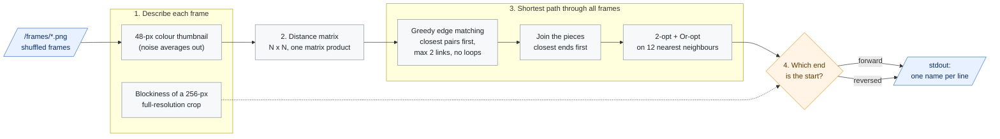
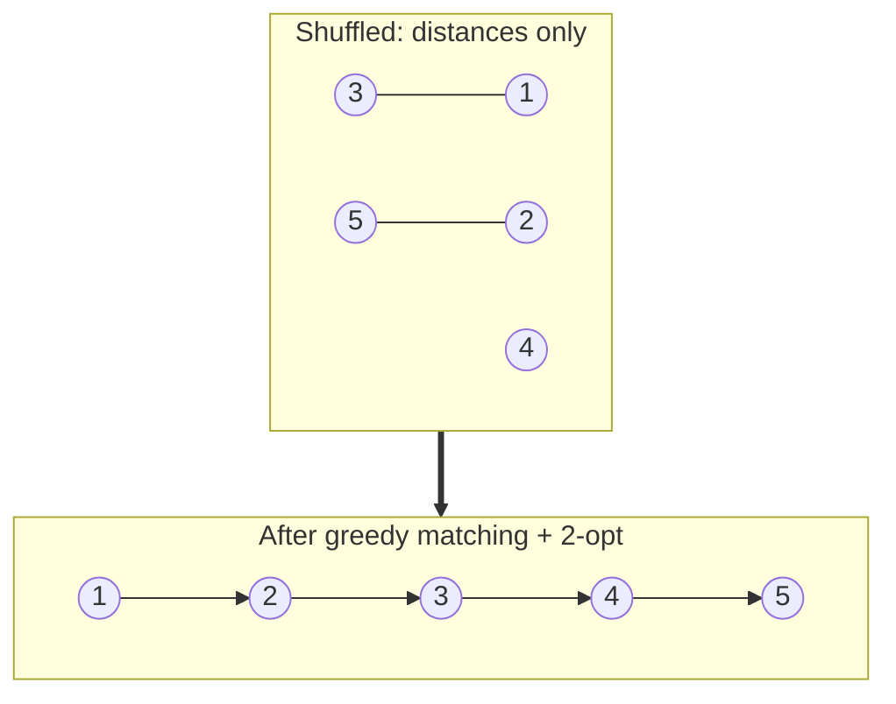

# Frame order

Someone has shuffled the frames of every video in our archive. Put them back in order.

> **Solution summary.** `order.py` treats the frames as points, measures how alike every
> pair of frames looks, and finds the shortest path that visits each frame once. Adjacent
> video frames are nearly identical, so the shortest path is the video. A compression cue
> then picks which end is the start. Python with numpy and Pillow only, no network or GPU.
> Details and known weak spots are in [NOTES.md](NOTES.md).

## How it works



| Step | What it does | Why |
|---|---|---|
| 1. Describe | Shrink each frame to a 48-pixel-wide colour thumbnail; measure blockiness on the codec's 4/8/16-pixel grid | Neighbouring frames have almost the same thumbnail; blockiness carries a faint trace of the encoder's key frames |
| 2. Distance | Euclidean distance between every pair of thumbnails (float32, one matrix product) | Fast even for thousands of frames |
| 3. Path | Greedy edge matching, then 2-opt and Or-opt, with a dummy frame so the path's ends can move | An open travelling-salesman path through frames is the most likely original order |
| 4. Direction | Small frame-to-frame steps in blockiness tend to fall between key frames | A path reads the same both ways. This is the weak step (about 60% on tests) |

### How the path is built



Each frame keeps at most two links, so the links form chains. The closest chain ends are
joined until one path remains, then 2-opt (reverse a stretch) and Or-opt (move a run of
1 to 3 frames) remove any detours.

## Run it

```
docker build -t frame-order .
docker run --rm --network none -v /path/to/video/:/frames:ro frame-order
```

Or without Docker: `pip install -r requirements.txt && python order.py path/to/frames`.

## Results on test videos

The only real video provided is `examples/digits`, which comes out 1, 2, 3, 4, 5. For more
coverage I generated clips with ffmpeg (moving patterns, a Mandelbrot zoom, a pan over a
texture, a scene cut), encoded them with H.264, VP9 or MPEG-4, and shuffled the PNGs.

| Test | Frames | True neighbours kept next to each other | Time |
|---|---|---|---|
| 7 short clips, 320x240 | 150-200 | 100% | 1.5-6 s |
| Two scenes with a hard cut, 640x360 | 1,500 | 100% | 12 s |
| Camera pan, 1920x1080 | 300 | 100% | 7 s (21 s in Docker) |

Getting **which end is the start** right is the open problem: see [NOTES.md](NOTES.md).

## Files

| File | Purpose |
|---|---|
| `order.py` | The solution |
| `Dockerfile`, `requirements.txt` | `python:3.12-slim` with numpy and Pillow |
| `NOTES.md` | What I tried and where it still goes wrong |
| `examples/digits/` | The sample video from the task |

---

## The task (original brief)

### Input

A video is a directory of PNG frames. The names are random. All frames in a video are
the same size. There is no audio.

`examples/digits/` is a tiny video of five frames showing the numbers 1 to 5, shuffled.
We score your solution on real videos.

### What to write

A git repo with a `Dockerfile` at the root. We build it once, then run it on each video:

```
docker build -t frame-order .
docker run --rm --network none -v /path/to/video/:/frames:ro frame-order
```

Your program prints the names of the frames to standard output, one per line, in your
best guess at their original order. Every frame appears exactly once.

### Rules

Don't expect internet access or a GPU when your program is running.

Use whatever tools you like, AI assistants included.

### Submitting

1. Click "Use this template" to make a private copy. Don't fork it.
2. Add your solution, and a short `NOTES.md` on what you tried and where it still goes
   wrong.
3. Add [@grist-hiring](https://github.com/grist-hiring) as a collaborator (Settings >
   Collaborators).
4. Fill in [this form](https://hiring.getgrist.com/forms/46sui68xMKyENn1AT4H6SY/7) with your
   repo URL and your resume. If you prefer, put your resume in the repo instead, as
   `RESUME.md` or `RESUME.pdf` at the top level.

Submissions must be in a private repo to be reviewed.
